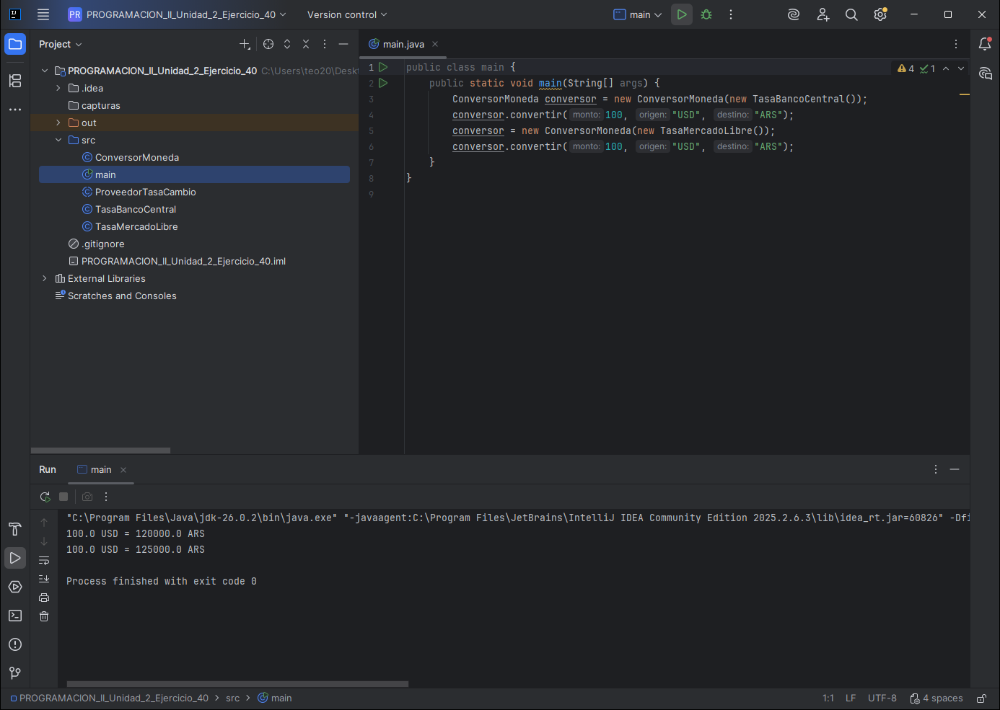

# PROGRAMACIÓN II — Unidad 2, Ejercicio 40: El Sistema de Conversión de Divisas

Trabajo práctico de Programación II. Este repositorio contiene la resolución en Java del ejercicio 40 de la Unidad 2.

## Consigna

#### Contexto

Una plataforma financiera global necesita convertir montos monetarios entre diferentes monedas extranjeras utilizando tasas de cambio actualizadas provistas por distintas fuentes (bancos locales, APIs de mercado o registros históricos). La modularidad asegura que la lógica contable no dependa de dónde provienen las cotizaciones.

#### Consigna

Modelar un sistema modular en Java que permita calcular equivalencias monetarias aplicando fuentes de conversión abstractas y desacopladas.

#### Desarrollo requerido

- Crear una clase abstracta ProveedorTasaCambio con un método abstracto double obtenerTasa(String monedaOrigen, String monedaDestino).
- Desarrollar clases concretas como TasaBancoCentral y TasaMercadoLibre que sobrescriban el método con valores simulados de cotización.
- Diseñar la clase ConversorMoneda que reciba un proveedor y un monto para realizar la operación matemática de conversión.
- En el método main, instanciar un conversor utilizando distintas fuentes de tasas de cambio de forma polimórfica y mostrar el resultado de la operación por consola.

## Estructura del repositorio

```
PROGRAMACION_II_Unidad_2_Ejercicio_40/
├── README.md
├── capturas/
│   └── consola.png
└── src/
    ├── ConversorMoneda.java
    ├── main.java   # clase con el método main
    ├── ProveedorTasaCambio.java
    ├── TasaBancoCentral.java
    └── TasaMercadoLibre.java
```

## Funcionamiento y lógica

El ejercicio usa una **clase abstracta** para convertir monedas con distintas fuentes de cotización.

### `ProveedorTasaCambio` (clase abstracta)

Define el método abstracto `obtenerTasa(String monedaOrigen, String monedaDestino)`.

### `TasaBancoCentral` y `TasaMercadoLibre`

Cada uno tiene su propia cotización del dólar:

- **Banco Central:** 1 USD = 1200 ARS.
- **Mercado libre:** 1 USD = 1250 ARS.

Para ARS → USD devuelven la tasa inversa, y para cualquier otro par de monedas devuelven 0.

### `ConversorMoneda`

Recibe un proveedor de tasas en el constructor. Su método `convertir(monto, origen, destino)` pide la tasa al proveedor y, si el monto y la tasa son positivos, muestra el resultado de la conversión; si no, informa que no se pudo convertir.

### `main`

Convierte **100 USD a pesos** con cada proveedor: con el Banco Central da **120000 ARS** y con el mercado libre **125000 ARS**.

## Ejecución

Captura de la consola de IntelliJ IDEA ejecutando el programa:



Salida obtenida:

```
100.0 USD = 120000.0 ARS
100.0 USD = 125000.0 ARS
```
